# OmniStream Pro v2.6.0

[](https://github.com/Xmon4u/OmniStream-Pro-v2/releases)
[](https://github.com/Xmon4u/OmniStream-Pro-v2)
[](extension)
[](LICENSE)

Universal media stream downloader and browser bridge suite for Windows. Captures adaptive HLS (`.m3u8`) and DASH (`.mpd`) video streams, preserves all available audio language tracks, and multiplexes them into lossless `.mkv` files.

## Highlights

- **Concurrent Multi-File Downloads**: Process multiple streams simultaneously, each with independent progress bars, speed indicators (MB/s), and cancel controls.
- **Multi-Track Audio Multiplexing**: Automatically downloads and merges all language tracks into a single container with proper track labels.
- **Media Title Resolver**: Automatically identifies movie/show metadata from IMDb IDs (`tt...`), TMDB, and Netflix parameters, renaming downloaded files to standardized formats (e.g., `Title (Year) S01E02.mkv`).
- **Browser Extension Bridge**: Transfer detected playlists and authentication headers directly from Chrome, Edge, or Brave over a local HTTP socket (`127.0.0.1:28795`).
- **cURL Importer**: Paste raw `curl` commands from browser DevTools; cookies, referers, user-agents, and auth tokens are parsed automatically.
- **Automatic Tool Setup**: Auto-detects and installs required streaming helpers (`N_m3u8DL-RE` and `ffmpeg`) on first run.
- **Auto-Cleanup**: Removes temporary segments and partial files upon completion, leaving only the final media file.
- **Windows Integration**: Includes desktop shortcuts, custom dark theme, and an optional Inno Setup installer with Control Panel uninstallation support.

## Architecture

```mermaid
graph LR
    subgraph Browser ["Browser Extension (Manifest V3)"]
        Sniffer["Network Sniffer & DOM Scanner"]
        ExtUI["Popup Interface & Queue"]
        Sniffer --> ExtUI
    end

    subgraph Bridge ["Local Bridge"]
        HttpBridge["HTTP Listener (127.0.0.1:28795)"]
    end

    subgraph Desktop ["OmniStream Pro Desktop"]
        AppUI["CustomTkinter Interface"]
        TitleResolver["Title Resolver (IMDb / TMDB / Netflix)"]
        Engine["Downloader Engine (N_m3u8DL-RE + FFmpeg)"]
        FinalOutput["Lossless MKV Container"]

        AppUI --> TitleResolver
        TitleResolver --> Engine
        Engine --> FinalOutput
    end

    ExtUI -->|"Send URL + Headers"| HttpBridge
    HttpBridge --> AppUI
```



## Installation & Setup

### Option 1: Windows Installer or Portable EXE
1. Download `OmniStream_Pro_Setup.exe` (or the portable binary) from [GitHub Releases](https://github.com/Xmon4u/OmniStream-Pro-v2/releases/latest).
2. Follow the setup wizard or run the portable executable directly.

### Option 2: Run from Source

#### Prerequisites
- Windows 10 or 11
- Python 3.10+
- (Optional) CMake & MSVC for compiling native C++ core

```bash
# Clone the repository
git clone https://github.com/Xmon4u/OmniStream-Pro-v2.git
cd OmniStream-Pro-v2

# Install Python UI dependencies
pip install customtkinter requests

# Launch the desktop application
python desktop/main.py
```

### Browser Extension Setup

1. Open Chrome/Edge and go to `chrome://extensions`.
2. Enable **Developer mode** in the top-right corner.
3. Click **Load unpacked** and select the `extension/` folder inside this repository.
4. When OmniStream Pro is running, clicking **Send to App** in the extension popup automatically queues streams.

## Building from Source

### Native C++ Core
The native stream sniffer and HTTP bridge can be compiled with CMake:

```powershell
cd C++
mkdir build
cd build
cmake .. -A x64
cmake --build . --config Release
```

The compiled binary will be placed in `C++/bin/Release/omnistream_core.exe`.

### Packaging Windows Installer
To build the standalone installer using Inno Setup:

```bat
cd desktop
build_installer.bat
```

The output installer is generated in `desktop/dist/OmniStream_Pro_Setup.exe`.

## Project Structure

```text
OmniStream-Pro-v2/
├── C++/                    # High-performance native C++ engine & socket bridge
│   ├── src/                # WinHTTP client, JSON parser, server routes
│   └── CMakeLists.txt      # CMake build definitions
├── desktop/                # Python desktop application
│   ├── main.py             # Desktop GUI entry point
│   ├── bridge_server.py    # Localhost HTTP receiver
│   ├── download_engine.py  # N_m3u8DL-RE & FFmpeg runner
│   ├── title_resolver.py   # IMDb, TMDB & Netflix title resolver
│   └── bin/                # Streaming binaries (auto-downloaded)
├── extension/              # Chromium browser extension (Manifest V3)
├── assets/                 # Icons, themes, and graphics
├── RELEASE_NOTES.md        # Detailed version history
└── README.md
```

## License

This project is licensed under the [MIT License](LICENSE).
