# OmniStream Pro v2.0 — Universal Stream Downloader & Extension Suite

<div align="center">


### Universal Multi-Audio HLS/M3U8 Stream Downloader & IDM Desktop Bridge
**Enterprise-grade stream capture suite with concurrent multi-track audio preservation, browser extension integration, and high-speed batch queue processing.**

[](https://github.com/Xmon4u/OmniStream-Pro-v2/releases)
[](https://github.com/Xmon4u/OmniStream-Pro-v2)
[](extension)
[](LICENSE)

</div>

---

## ⚡ Overview

**OmniStream Pro v2.0** is an upgraded, all-in-one media downloading suite combining a high-performance Windows desktop application and a powerful Chrome/Edge browser extension.

Capture complex adaptive HLS/M3U8 and DASH video streams, automatically preserve **all available multi-language audio tracks**, and multiplex them into a single, clean `.mkv` container with zero quality loss. With IDM-grade batch queuing and live browser-to-desktop link forwarding, batch streaming downloads are now effortless and instant.

---

## ✨ Key Features

### 🖥️ Desktop Application (IDM-Grade Queue & Engine)
- **🚀 "Download All" (Batch Queue)**: Like Internet Download Manager (IDM), links sent from the extension or pasted manually queue up automatically. Click **"Download All"** to process the entire queue sequentially.
- **🎧 Lossless Multi-Audio MKV Muxing**: Downloads and muxes every audio track (English, Hindi, Bengali, etc.) directly into a single container with proper language track metadata.
- **⚡ 16x Parallel Segment Acceleration**: Leverages concurrent segment downloads (`-mt`) via N_m3u8DL-RE for maximum bandwidth utilization.
- **🌐 Dual-Mode Media Engine**: Supports both adaptive playlists (`.m3u8`, `.mpd`) and direct streaming video files (`.mp4`, `.mkv`, `.webm`, `.mp3`).
- **📋 Intelligent cURL Importer**: Paste any raw `cURL (bash)` or `cURL (cmd)` copied directly from browser DevTools; headers, cookies, referers, and tokens are parsed automatically.
- **🛡️ Auto-Dependency Management**: Automatically checks and downloads verified releases of `N_m3u8DL-RE` and `ffmpeg` if missing.
- **📊 Real-Time Activity Terminal**: Live logging console with progress bar, completion status, and log export.
- **🛑 Safe Abort Handling**: Stop and clean up any ongoing download instantly at any moment.

### 🧩 Browser Extension (Chrome / Edge / Chromium)
- **⚡ Instant Desktop Transfer**: Transfer single or all detected streams directly into the OmniStream Pro desktop application queue via the localhost bridge (`127.0.0.1:28795`).
- **🚀 1-Click "Send All to App"**: Send every detected video stream on the active webpage to the desktop app in a single click.
- **🎯 Multi-Format Sniffer**: Intercepts HLS (`.m3u8`), DASH (`.mpd`), MP4, MKV, and WebM video streams in real time.
- **🛡️ God Mode Deep Probe**: Deep DOM scanner and player stimulator that surfaces hidden or obfuscated video streams behind complex players.
- **🔓 Anti-DevTools & Anti-F12 Neutralizer**: Unblocks F12, developer tools, and right-click context menus on video websites.
- **📋 Full Header & cURL Preservation**: Captures User-Agent, Referer, Origin, Cookies, and Authorization headers for exact replay.

---

## 🏗️ System Architecture

```mermaid
graph LR
    subgraph Browser ["Web Browser (Chrome / Edge)"]
        WebPage["Web Page & Media Player"]
        GodMode["God Mode Sniffer & Anti-DevTools"]
        ExtSW["Extension Service Worker"]
        Popup["Extension UI (Streams & Queue)"]
        WebPage --> GodMode
        GodMode --> ExtSW
        ExtSW --> Popup
    end

    subgraph Bridge ["Local Bridge (127.0.0.1:28795)"]
        BridgeServer["HTTP Bridge Server (/add, /batch_add)"]
    end

    subgraph DesktopApp ["OmniStream Pro Desktop v2.0"]
        GUI["CustomTkinter Dark GUI"]
        QueueMgr["IDM Queue Manager (Download All)"]
        Engine["High-Speed Engine (N_m3u8DL-RE + FFmpeg)"]
        OutputMKV["Multi-Audio Lossless MKV File"]
        GUI --> QueueMgr
        QueueMgr --> Engine
        Engine --> OutputMKV
    end

    Popup -- "⚡ Send All / Send Stream" --> BridgeServer
    BridgeServer --> GUI
```



---

## 🚀 Getting Started

### 1. Launching the Desktop Application

#### Option A: Standalone Executable
1. Download `OmniStream_Pro.exe` from [GitHub Releases](https://github.com/Xmon4u/OmniStream-Pro-v2/releases).
2. Double-click to launch—ready out of the box!

#### Option B: Run from Source
```bash
# Clone the repository
git clone https://github.com/Xmon4u/OmniStream-Pro-v2.git
cd OmniStream-Pro-v2/desktop

# Install Python requirements
pip install customtkinter

# Run the modern GUI
python main_gui.py
```
*(Or simply double-click `Start_OmniStream_Pro.bat` in the root folder).*

---

### 2. Installing the Browser Extension

1. Open Google Chrome, Edge, or Brave.
2. Go to `chrome://extensions/` (or `edge://extensions/`).
3. Enable **Developer mode** toggle in the top-right corner.
4. Click **Load unpacked** and select the `extension` folder inside this repository.
5. The **OmniStream Pro** icon will appear in your browser toolbar!

---

## 📖 How to Download Streams (IDM Workflow)

1. Open **OmniStream Pro** desktop application. (The status badge will confirm `🌐 Extension Bridge: Active`).
2. In your browser, open any website with video content and play the video.
3. Click the **OmniStream Pro** extension icon.
4. You will see all detected video streams.
5. Click **"🚀 Send All to App"** to transfer all links to the software at once (or click **"⚡ Send to App"** on individual streams).
6. In **OmniStream Pro**, your streams will be queued up in the **IDM Download Queue**.
7. Click **"▶ Download All (Start Queue)"**.
8. OmniStream Pro will download all video segments and multi-language audio tracks concurrently, multiplexing each into a lossless `.mkv` file saved to your chosen folder!

---

## 🛠️ Building Standalone Executable (.exe)

To compile the single-file Windows executable:

```bash
cd desktop
python build_exe.py
```
The compiled binary will be placed in `desktop/dist/OmniStream_Pro.exe`.

---

## 📂 Project Structure

```
OmniStream_Pro_v2/
├── desktop/
│   ├── main_gui.py              # CustomTkinter IDM-style desktop application
│   ├── core_engine.py           # Multi-audio download manager & FFmpeg muxer
│   ├── bridge_server.py         # Localhost browser bridge server (127.0.0.1:28795)
│   ├── setup_dependencies.py    # Auto-downloader for N_m3u8DL-RE and FFmpeg
│   ├── build_exe.py             # PyInstaller one-file executable builder
│   ├── app_icon.ico             # Windows application icon
│   └── app_icon.png             # Application logo artwork
│
├── extension/
│   ├── manifest.json            # Chrome MV3 manifest
│   ├── background.js            # Background network sniffer & bridge dispatcher
│   ├── content.js               # Content script & DOM injector
│   ├── godmode.js               # Deep DOM scanner & anti-devtools protector
│   ├── popup.html               # Extension user interface
│   ├── popup.css                # Dark modern cyberpunk stylesheet
│   ├── popup.js                 # Popup controller & batch transfer logic
│   └── icons/                   # Extension icons (16, 32, 48, 128)
│
├── Start_OmniStream_Pro.bat     # Quick desktop launcher script
├── build_release.py             # Automated release builder (.exe and extension .zip)
├── LICENSE                      # MIT Open Source License
└── README.md                    # Comprehensive documentation
```

---

## 👤 Author

**XMON4U**
- GitHub: [@Xmon4u](https://github.com/Xmon4u)

---

## 📄 License

This project is licensed under the MIT License — see the [LICENSE](LICENSE) file for details.
