# OmniStream Pro v2.0 — Universal Stream Downloader & Extension Suite

<div align="center">


### Universal Multi-Audio HLS/M3U8 Stream Downloader & Browser Bridge

**High-performance stream download suite with concurrent multi-track audio preservation, browser extension integration, and batch queue processing.**

[](https://github.com/Xmon4u/OmniStream-Pro-v2/releases)
[](https://github.com/Xmon4u/OmniStream-Pro-v2)
[](extension)
[](LICENSE)

</div>

---

## Overview

**OmniStream Pro v2.0** is an all-in-one media downloading suite combining a Windows desktop application and a Chrome/Edge browser extension.

Capture adaptive HLS/M3U8 and DASH video streams, automatically preserve all available multi-language audio tracks, and multiplex them into a single `.mkv` container with no quality loss. With batch queuing and live browser-to-desktop link forwarding, downloading streams from any website is straightforward.

---

## Key Features

### Desktop Application

- **Batch Queue**: Links sent from the extension or pasted manually queue up automatically. Click **Download All** to process the entire queue.
- **Multi-Audio MKV Muxing**: Downloads and muxes every audio track into a single container with proper language track metadata.
- **16x Parallel Segment Downloads**: Concurrent segment downloads via N_m3u8DL-RE for maximum speed.
- **Dual-Mode Engine**: Supports both adaptive playlists (`.m3u8`, `.mpd`) and direct video files (`.mp4`, `.mkv`, `.webm`, `.mp3`).
- **cURL Importer**: Paste any `cURL (bash)` or `cURL (cmd)` command from browser DevTools; headers, cookies, referers, and tokens are parsed automatically.
- **Auto-Dependency Management**: Automatically downloads `N_m3u8DL-RE` and `ffmpeg` if they are missing.
- **Live Terminal**: Real-time logging console with progress bar, completion status, and log export.
- **Safe Abort**: Stop any ongoing download cleanly at any point.

### Browser Extension (Chrome / Edge / Chromium)

- **Instant Desktop Transfer**: Send single or all detected streams directly to the desktop application queue via the localhost bridge (`127.0.0.1:28795`).
- **Send All to App**: Forward every detected video stream on the active webpage to the desktop app in a single click.
- **Multi-Format Sniffer**: Intercepts HLS (`.m3u8`), DASH (`.mpd`), MP4, MKV, and WebM video streams in real time.
- **God Mode Deep Probe**: DOM scanner and player stimulator that surfaces hidden or obfuscated video streams.
- **Anti-DevTools Neutralizer**: Re-enables F12, developer tools, and right-click context menus on video websites.
- **Full Header Preservation**: Captures User-Agent, Referer, Origin, Cookies, and Authorization headers for exact request replay.

---

## System Architecture

```mermaid
graph LR
    subgraph Browser ["Web Browser (Chrome / Edge)"]
        WebPage["Web Page & Media Player"]
        GodMode["God Mode Sniffer & Anti-DevTools"]
        ExtSW["Extension Service Worker"]
        Popup["Extension UI (Streams & Queue)"]
        WebPage --> GodMode
        GodMode --> ExtSW
        ExtSW --> Popup
    end

    subgraph Bridge ["Local Bridge (127.0.0.1:28795)"]
        BridgeServer["HTTP Bridge Server (/add, /batch_add)"]
    end

    subgraph DesktopApp ["OmniStream Pro Desktop v2.0"]
        GUI["CustomTkinter Dark GUI"]
        QueueMgr["Queue Manager (Download All)"]
        Engine["High-Speed Engine (N_m3u8DL-RE + FFmpeg)"]
        OutputMKV["Multi-Audio Lossless MKV File"]
        GUI --> QueueMgr
        QueueMgr --> Engine
        Engine --> OutputMKV
    end

    Popup -- "Send All / Send Stream" --> BridgeServer
    BridgeServer --> GUI
```



---

## Getting Started

### 1. Desktop Application

#### Option A: Standalone Executable
1. Download `OmniStream_Pro.exe` from [GitHub Releases](https://github.com/Xmon4u/OmniStream-Pro-v2/releases).
2. Double-click to launch.

#### Option B: Run from Source
```bash
git clone https://github.com/Xmon4u/OmniStream-Pro-v2.git
cd OmniStream-Pro-v2/desktop

pip install customtkinter
python main_gui.py
```

Or double-click `Start_OmniStream_Pro.bat` in the root folder.

---

### 2. Browser Extension

1. Open Google Chrome, Edge, or Brave.
2. Go to `chrome://extensions/` (or `edge://extensions/`).
3. Enable **Developer mode** in the top-right corner.
4. Click **Load unpacked** and select the `extension` folder inside this repository.

---

## How to Download Streams

1. Open **OmniStream Pro** desktop application.
2. In your browser, navigate to any website with video content and play the video.
3. Click the **OmniStream Pro** extension icon.
4. Click **Send All to App** to queue all detected streams, or **Send to App** for individual streams.
5. In OmniStream Pro, click **Download All (Start Queue)**.

OmniStream Pro downloads all video segments and audio tracks concurrently, muxing each into a lossless `.mkv` file in your chosen output folder.

---

## Building Standalone Executable (.exe)

```bash
cd desktop
python build_exe.py
```

The compiled binary will be placed at `desktop/dist/OmniStream_Pro.exe`.

---

## Project Structure

```
OmniStream_Pro_v2/
├── desktop/
│   ├── main_gui.py              # CustomTkinter desktop application
│   ├── core_engine.py           # Multi-audio download manager & FFmpeg muxer
│   ├── bridge_server.py         # Localhost browser bridge server (127.0.0.1:28795)
│   ├── setup_dependencies.py    # Auto-downloader for N_m3u8DL-RE and FFmpeg
│   ├── build_exe.py             # PyInstaller one-file executable builder
│   ├── app_icon.ico             # Windows application icon
│   └── app_icon.png             # Application logo
│
├── extension/
│   ├── manifest.json            # Chrome MV3 manifest
│   ├── background.js            # Background network sniffer & bridge dispatcher
│   ├── content.js               # Content script & DOM injector
│   ├── godmode.js               # Deep DOM scanner & anti-devtools protector
│   ├── popup.html               # Extension user interface
│   ├── popup.css                # Dark stylesheet
│   ├── popup.js                 # Popup controller & batch transfer logic
│   └── icons/                   # Extension icons (16, 32, 48, 128)
│
├── Start_OmniStream_Pro.bat     # Quick desktop launcher
├── build_release.py             # Release builder (.exe and extension .zip)
├── LICENSE                      # MIT License
└── README.md                    # Documentation
```

---

## Author

**XMON4U** — [GitHub: @Xmon4u](https://github.com/Xmon4u)

---

## License

This project is licensed under the MIT License — see the [LICENSE](LICENSE) file for details.
